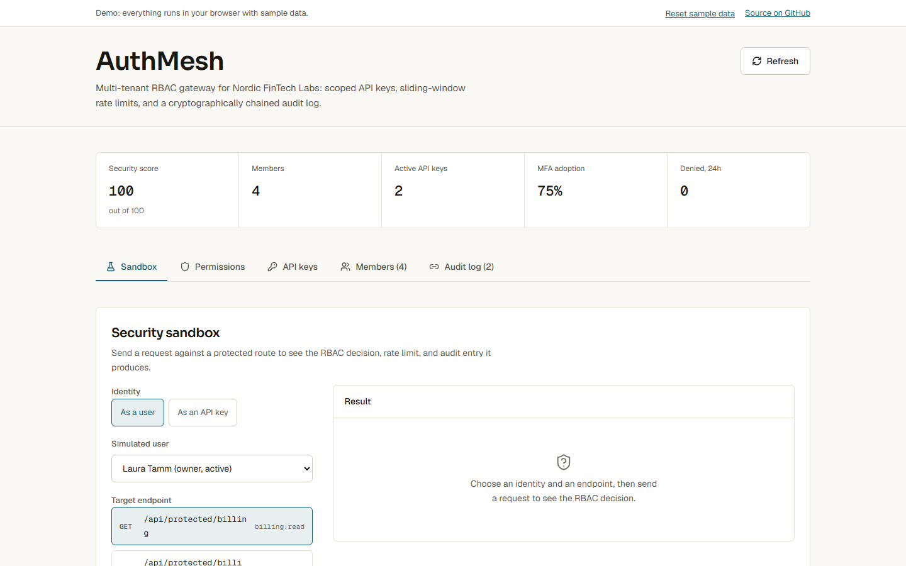
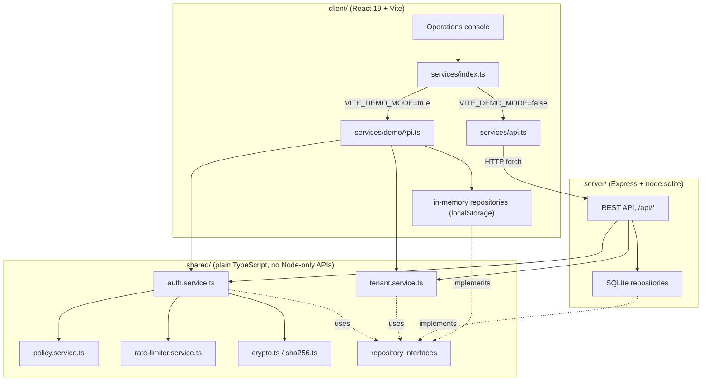

# AuthMesh

AuthMesh is a multi-tenant RBAC gateway: it evaluates permissions for users and scoped API keys, enforces per-key rate limits, and records every access decision in a SHA-256 hash-chained audit ledger. It ships with a React console for managing users and roles, generating and revoking API keys, watching the audit trail, and testing protected endpoints interactively.

[](https://github.com/Taan1el/authmesh/actions/workflows/ci.yml)
[](https://github.com/Taan1el/authmesh/actions/workflows/pages.yml)
[](LICENSE)

**Live demo:** https://taan1el.github.io/authmesh/

The demo runs entirely in your browser: the same RBAC engine, rate limiter and audit-chain code the server uses runs against an in-memory, localStorage-backed store instead of a real API, so it works with no backend. It is also an access policy designer you can use with your own policy file: see [Use it with your own data](#use-it-with-your-own-data).

## Who this is for

Teams that need to hand a service, script, or contractor a scoped, revocable credential instead of a shared admin password; enforce who can do what by role; and be able to show, after the fact, that the access log has not been altered. AuthMesh is the gateway and its policy engine, not a full identity provider: it does not do SSO, password login, or OAuth.

## Screenshot



More screenshots: [RBAC policy matrix](docs/screenshots/02-rbac-matrix.png), [chained audit log](docs/screenshots/03-audit-log.png), [phone width](docs/screenshots/04-mobile.png).

## Features

- **Hierarchical RBAC**: exact permissions (`users:read`), namespace wildcards (`billing:*`), and the universal wildcard (`*`), evaluated against a user's role or an API key's scopes.
- **Scoped API key vault**: keys (`am_live_<64-char hex>`) are shown in full exactly once at creation and stored only as a SHA-256 hash; revoking or letting one expire blocks it on the next request.
- **Sliding-window rate limiting** per API key, with `X-RateLimit-Limit` / `X-RateLimit-Remaining` / `X-RateLimit-Reset` headers and HTTP 429 once a key's quota is spent.
- **Hash-chained audit ledger**: every grant, denial and administrative change is linked to the previous entry by a SHA-256 hash; a verification endpoint walks the whole chain and reports the first broken block, if any.
- **Interactive security sandbox**: dispatch a request at a protected endpoint as any seeded user or API key (including an invalid one) and see the resulting HTTP status, rate-limit headers, and response body.
- **Tenant administration**: invite users, change roles, suspend and reactivate accounts, and view a live security-posture score built from MFA adoption, audit chain integrity and recent denials.
- **GitHub Pages demo mode**: no backend required; the exact same policy code runs client-side against seeded, localStorage-backed data, with a "Reset sample data" control.
- **Access policy designer** (Pages build): design a policy in your own browser workspace, test who can do what, review changes between versions and verify an exported audit log. See [Use it with your own data](#use-it-with-your-own-data).

## Use it with your own data

The live page doubles as an access policy designer. It designs and tests a policy; it does not protect a live API. There is no server and no account: everything runs and stays in your browser.

Switch **Data source** from "Sample data" to "Your workspace", then either import a `policy.json` file, start from the sample policy, or start empty.

- **Policy file.** A versioned JSON file with roles, their permissions and the members who hold them. Permissions are the same strings the gateway uses: `*`, `billing:*` or `users:read`. A member holds one role and is active or suspended, as on the server. The `tenant` label is optional. The file is checked completely before anything is saved, and every problem is reported with its path, for example `roles[1].permissions[0]: expected "*", "resource:*" or "resource:action" using lowercase letters only, got "Users:Read"`.

  ```json
  {
    "version": 1,
    "tenant": "Example Org",
    "roles": [
      { "name": "admin", "description": "Runs the place", "permissions": ["users:*", "keys:read"] },
      { "name": "reader", "permissions": ["users:read"] }
    ],
    "members": [
      { "email": "ada@example.test", "name": "Ada", "role": "admin" },
      { "email": "bo@example.test", "role": "reader", "status": "suspended" }
    ]
  }
  ```

- **Import and export.** Import states what the file holds and what it replaces (counts of roles and members) before it saves anything. Export writes `policy.json`. After a change the page reminds you, quietly, that the workspace lives only in this browser until you export a backup.
- **Permissions and Members.** In your workspace you can add, edit and delete roles and add, move, suspend and remove members. While you edit a role, the dialog shows which scopes you are adding or removing and which members gain or lose which permission.
- **Access test.** Pick or type a member or a role and a permission, or a request line such as `GET /api/protected/billing`, and get Allowed or Denied with the exact reason and the scope or role behind it. The answer comes from the same code the server runs for a user request (`shared/access-decision.ts` and `shared/policy.service.ts`), and a test checks that the two agree for every member and permission of a sample policy. Request lines map to permissions through `shared/routes.ts`, which lists the four guarded sample routes; for any other route, ask about a permission instead.
- **Changes.** Compare two versions of a policy: the current one, the baseline (the version you last exported, imported or started from) or any policy file. It lists the exact scopes added and removed from each role, the members added, removed, moved or suspended, and per member the permissions gained and lost. Wildcards are checked against the standard permissions plus every permission a role names, and the page says how many. Export the result as a Markdown change review.
- **Audit log verifier.** Under Audit log, paste or open a log exported from AuthMesh (a list of entries, or an object with them under `events`). The page recomputes every hash with the same function the server uses, and shows whether the chain is intact or where it first breaks: a changed entry, a removed or moved one, or a missing start. Entries are shown 25 to a page, so imported logs are not cut off at 100 (up to 200,000 entries and 25 MB). In sample mode, "Export current log" writes the demo's own ledger in that format. The chain covers the previous hash, actor id, action, resource, status, time and details. Changing only an actor name, IP address or user agent is not detected.
- **Offline.** The Pages build registers a service worker, so after one visit it loads without a network. When a new version is published, the page shows "A new version is ready." with a Reload button; it never reloads by itself. A strict Content-Security-Policy allows no other hosts.

Your workspace is stored in IndexedDB with a revision number. If you open the page in two tabs, a change saved in one is picked up by the other, and a stale edit is refused rather than overwriting it. Clearing site data removes the workspace, so export a backup.

## Getting started

### Prerequisites
- Node.js 22.5 or newer (built and tested on Node.js 24; `node:sqlite` needs 22.5+)
- npm 10 or newer

### Install
```bash
git clone https://github.com/Taan1el/authmesh.git
cd authmesh
npm install
```

### Run
```bash
npm run dev
```
This starts the Express API on port 4000 and the Vite dev server on port 5173. Open **http://localhost:5173**.

### Environment variables
None of these are required to run the defaults shown above.

| Variable | Used by | Default | Purpose |
|---|---|---|---|
| `PORT` | server | `4000` | Port the Express gateway listens on. See `server/.env.example`. |
| `VITE_PORT` | client (dev only) | `5173` | Port the Vite dev server listens on. See `client/.env.example`. |
| `VITE_API_TARGET` | client (dev only) | `http://localhost:4000` | Where the Vite dev server proxies `/api` requests, for when the server runs on a different port. |
| `VITE_DEMO_MODE` | client (build only) | unset | Set to `true` to build the in-browser demo instead of the real API client. Set automatically by `npm run build:pages` via `client/.env.pages`; you should not need to set it by hand. |

## Scripts

Run from the repo root unless noted otherwise.

| Script | What it does |
|---|---|
| `npm run dev` | Runs the server (`tsx watch`) and client (Vite) together |
| `npm run build` | Builds the server, then the client, for production |
| `npm run build:pages` | Builds the client in demo mode (`client/dist`), for GitHub Pages |
| `npm test` | Runs the server test suite, then the client test suite |
| `npm run lint` | Type-checks the server, then the client (`tsc --noEmit`) |

## How it works

`shared/` holds the RBAC and tenant logic used by both the server and the browser demo: `policy.service.ts` (wildcard permission matching), `rate-limiter.service.ts` (the sliding window), `crypto.ts` (API key hashing and the audit hash chain, parameterised over a SHA-256 function: the server passes `node:crypto`, the browser demo passes the small dependency-free implementation in `sha256.ts`; a parity test checks both give identical hashes), and `auth.service.ts` / `tenant.service.ts` (the actual RBAC decisions and tenant administration). Those two services depend only on the repository interfaces in `shared/repositories.ts`, not on a concrete database, so the server's SQLite-backed repositories and the browser demo's in-memory ones are interchangeable.



### Project layout

```
authmesh/
  client/                  React 19 + Vite operations console
    src/components/        Header, StatsBar, PermissionMatrix, ApiKeyVault, UserDirectory, AuditLedgerFeed, SecuritySandbox, DemoBanner
    src/services/           api.ts (real), demoApi.ts + demoDatabase.ts + demoRepositories.ts + demoSeed.ts (browser demo), index.ts (the switch)
  server/                  Express API
    src/app.ts             Express app: CORS, JSON body parsing, API mount, static client build
    src/db/                node:sqlite schema, connection and seed data
    src/repositories/       SQLite implementations of the shared repository interfaces
    src/controllers/        Request validation and response shaping
    src/routes/             Route table and RBAC middleware wiring
  shared/                  RBAC engine, tenant service, crypto and repository interfaces used by both server and client (see above)
  docs/adr/                Architecture decision records
  docs/screenshots/        README screenshots
```

## API reference

All routes are mounted under `/api`. Successful responses are `{ "success": true, "data": ... }` except `/api/health` (no wrapper) and the four `/api/protected/*` sandbox routes (`{ "success": true, "message": ..., "actor": ..., ... }`, no `data` key). Errors are always `{ "success": false, "error": "..." }`. Checked against `server/src/routes/api.routes.ts` and its controllers.

| Method | Path | Body / query | Notes |
|---|---|---|---|
| GET | `/api/health` | - | `{ status, timestamp }` |
| POST | `/api/auth/evaluate` | `{ token? , user_id?, permission, resource }` | Dry-run permission check; returns an `AccessEvaluationResult` without hitting a real resource |
| GET | `/api/auth/verify-chain` | - | Walks the audit ledger and reports whether the hash chain is intact |
| GET | `/api/users` | - | List tenant members |
| POST | `/api/users` | `{ name, email, role, mfa_enabled? }` | 400 on invalid email/role or a duplicate email |
| PATCH | `/api/users/:id/role` | `{ role }` | 404 unknown user, 400 unknown role |
| PATCH | `/api/users/:id/status` | `{ status: "active" \| "suspended" }` | 404 unknown user |
| GET | `/api/roles` | - | List roles with their permission sets |
| PUT | `/api/roles/:name/permissions` | `{ permissions: string[] }` | 404 unknown role, 400 malformed permission string |
| GET | `/api/keys` | - | List API keys (masked prefix only, never the token or hash) |
| POST | `/api/keys` | `{ name, scopes, rate_limit_rpm?, expires_in_days? }` | Returns `plaintext_token` once; 400 on empty scopes |
| DELETE | `/api/keys/:id` | - | Revokes immediately; 404 unknown key |
| GET | `/api/audit` | `?limit=` (default 100, max 500) | Most recent ledger entries first |
| GET | `/api/metrics` | - | Tenant security score, MFA adoption, active keys, recent denials |
| GET | `/api/protected/billing` | - | Sandbox route; requires `billing:read` |
| POST | `/api/protected/billing/invoice` | - | Sandbox route; requires `billing:write` |
| GET | `/api/protected/users` | - | Sandbox route; requires `users:read` |
| POST | `/api/protected/deploy` | - | Sandbox route; requires `deploy:execute` |

Every `/api/protected/*` route identifies the actor from either an `Authorization: Bearer <api key>` header or an `x-user-id: <user id>` header; `/api/auth/evaluate` takes the same choice as `token` or `user_id` fields in the JSON body instead, since it has no real resource to guard. An unrecognized token is a 401; a recognized-but-insufficiently-scoped token, role, revoked key, or suspended user is a 403; a rate-limited key is a 429. Shapes (`User`, `Role`, `ApiKey`, `AuditEvent`, `TenantSecurityMetrics`, `AccessEvaluationResult`) are defined in `shared/types.d.ts`.

## Testing

- **RBAC and tenant logic** (`server/test`, via `supertest`): the happy path for every route, permission grants and denials by role and by API key scope, rate-limit enforcement, revoked/expired keys, input validation (400s), the 404 path, and that error responses never leak internal detail.
- **Client** (`client/src/test`, React Testing Library): dashboard rendering across every tab, the sandbox's dispatch flow (including a regression test for a bug where the first request could be sent with no selected user), keyboard access to the endpoint picker, and the create-key modal's dialog semantics and focus handling.
- **Demo adapter** (`client/src/test/demoApi.test.ts`): the same RBAC and tenant behavior as the server tests, run against the in-memory store: seeded data, user and key administration, permission grants/denials, rate limiting, the audit hash chain, reset, and persistence across a simulated page reload.
- **Accessibility** (`client/src/test/Accessibility.test.tsx`, `vitest-axe`): automated WCAG 2 A and AA checks on every sidebar view and both dialogs, plus keyboard tests for the sidebar tabs and the dialog focus trap. Color contrast cannot be computed in jsdom, so it is checked outside the test suite.

- **Policy tools** (`server/test/policy-*.test.ts`, `audit-verify.test.ts`): the policy file parser and its error messages, the access test checked against the server's own `AuthService` for every member and permission, the route table checked against the running gateway, the policy diff and its Markdown output, and the audit chain verifier (intact, tampered, rehashed, reordered, removed and truncated logs, in both orders).
- **Browser workspace** (`client/src/test`): the IndexedDB store with revision checks and changes from another tab, the import confirmation, the access test, the changes view, the log verifier with pagination, and axe checks on each of those screens. `localBuild.test.ts` builds the Pages bundle and tests the Content-Security-Policy, the manifest and the service worker.

Run everything with `npm test` (or `npm run test:server` / `npm run test:client` separately).

## Deployment

### Docker
```bash
docker compose up --build
```
Serves the built client and API together at **http://localhost:4000**. The image runs as the unprivileged `node` user. Docker was not available while preparing this repository, so the image is only verified by the `docker` job in CI (`docker build`); if `docker compose up` does not work for you, please open an issue.

### GitHub Pages
`.github/workflows/pages.yml` runs `npm run build:pages` and publishes `client/dist` on every push to `main`. The deploy step is skipped while the repository is private and starts working once it is made public.

## Design notes and limitations

- There is no login or session of its own: the console and the sandbox identify an actor by an API key or by picking a user id directly, which is realistic for a gateway sitting behind something else but is not a substitute for real authentication in front of it.
- The audit ledger's hash chain proves the log was not edited after the fact; it does not, by itself, stop someone with direct database access from truncating the table and starting a new chain. Treat it as tamper-evidence, not tamper-proofing.
- Rate limiting is in-memory and per-process; it resets on restart and is not shared across multiple server instances.
- The GitHub Pages demo stores its data in the browser's localStorage: it is per-browser, not shared between visitors, and can be cleared by the browser (private windows, storage limits) at any time.
- The policy designer checks a policy against the same matching rules as the gateway but it is not connected to one: it cannot change a running server. It has no role inheritance and no per-tenant separation, because the server has neither; the optional `tenant` is only a label.
- This has not had a professional security review. Treat it as a working implementation of RBAC, scoped credentials and tamper-evident logging, not as a drop-in production auth gateway.

## Roadmap

- Real authentication in front of the console itself (it currently trusts whoever can reach it).
- Per-tenant isolation for more than one organization in the same deployment.
- Export the audit ledger (CSV/JSON) from the server console for external compliance tooling. The Pages build already exports its own log as JSON.
- Editable permissions from the server console's RBAC matrix instead of only via the API. The Pages workspace already has this.

## License

MIT, see [LICENSE](LICENSE).
